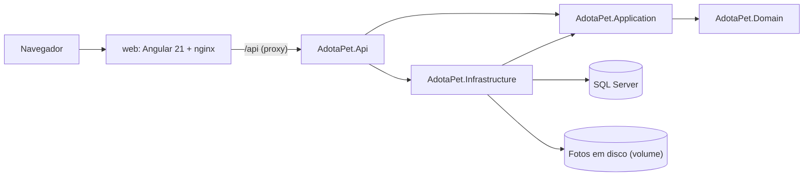

# AdotaPet

> **English summary:** AdotaPet is a full-stack pet adoption site (ASP.NET Core 10 + Angular 21 + SQL Server) built as a portfolio project. Shelters publish pets, adopters send adoption requests, and shelters approve or reject them.
> It runs with a single `docker compose up --build` and ships with demo data, Clean Architecture, role-based JWT auth, and automated tests with CI.

Site de adoção de animais: **ONGs** publicam pets disponíveis e **adotantes** enviam pedidos de adoção, que a ONG aprova ou recusa. Projeto de portfólio de Gustavo Piccoli, feito na stack .NET / Angular / SQL Server.

## Capturas de tela

As imagens serão adicionadas em `docs/images/` (pendente, ver [`docs/BACKLOG.md`](docs/BACKLOG.md)):

| Vitrine | Página do pet |
|---|---|
| `docs/images/vitrine.png` | `docs/images/pet.png` |

| Meus pets (ONG) | Pedidos recebidos (ONG) |
|---|---|
| `docs/images/ong-pets.png` | `docs/images/ong-pedidos.png` |

## Funcionalidades

- **Visitante:** navega pela vitrine (paginação no servidor, 12 por página) com filtros por espécie, porte, sexo, faixa de idade, UF e cidade; abre a página de cada pet.
- **Adotante:** cadastro e login, envia pedido de adoção com mensagem e acompanha a situação em "Meus pedidos" (Pendente, Aprovado, Recusado).
- **ONG:** cadastro (CNPJ validado), cadastra e edita os próprios pets com upload de foto, vê os pedidos recebidos com contato do adotante e aprova ou recusa.
- Aprovar um pedido marca o pet como adotado e recusa automaticamente os demais pedidos pendentes dele.
- Interface em português (pt-BR), responsiva.

## Como rodar

Pré-requisito: Docker com Docker Compose.

```bash
docker compose up --build
```

- Site: <http://localhost:4200>
- API: <http://localhost:5080> (documentação interativa Scalar: <http://localhost:5080/scalar>)
- SQL Server: `localhost:1433`

Na primeira subida a API aplica as migrations e popula dados de demonstração (apenas em `Development`, que é o ambiente usado pelo compose). Os valores padrão de senha do SA e chave JWT servem só para uso local; para trocá-los, copie `.env.example` para `.env`.

### Contas de demonstração

Senha de todas: `Adota123`

| Papel | E-mail |
|---|---|
| ONG | `abrigo@adotapet.dev` (Abrigo Patas Felizes, Porto Alegre/RS) |
| ONG | `ong@adotapet.dev` (ONG Focinhos do Bem, Curitiba/PR) |
| Adotante | `ana@adotapet.dev` |
| Adotante | `bruno@adotapet.dev` |

Os dados de exemplo incluem pets disponíveis e adotados, e pedidos nas três situações.

### Desenvolvimento sem compose

Requer .NET SDK 10, Node 24 e um SQL Server acessível (a connection string de `appsettings.Development.json` aponta para `localhost,1433`).

```bash
dotnet run --project src/AdotaPet.Api      # API em http://localhost:5080
cd web && npm ci && npm start              # SPA em http://localhost:4200, com proxy de /api para a porta 5080
```

## Arquitetura



As dependências entre projetos apontam para dentro (`Domain ← Application ← Infrastructure ← Api`) e são garantidas pelas referências de projeto. O Domain não tem nenhum pacote NuGet.

| Projeto | Responsabilidade |
|---|---|
| `AdotaPet.Domain` | Entidades, enums, regras e exceções de domínio, interfaces de repositório |
| `AdotaPet.Application` | Casos de uso (interface + implementação), DTOs, interfaces de serviços técnicos |
| `AdotaPet.Infrastructure` | EF Core e migrations, Identity, emissão de JWT, armazenamento de fotos, seed |
| `AdotaPet.Api` | Controllers, autenticação/autorização, `ProblemDetails`, OpenAPI + Scalar |
| `web/` | SPA Angular (componentes standalone, signals, Tailwind CSS) |

Cada projeto é organizado por funcionalidade (`Pets/`, `AdoptionRequests/`, `Shelters/`, `Adopters/`, `Accounts/`), com o aspecto técnico em subpastas.

## Decisões técnicas

- **Clean Architecture em projetos separados:** a direção das dependências é verificada pelo compilador, não por convenção.
- **Casos de uso como interface + classe, sem MediatR:** menos cerimônia para este tamanho, e o registro explícito no DI deixa o fluxo fácil de seguir.
- **Regras nas entidades:** as entidades se validam e lançam exceções de domínio; a API as traduz em `ProblemDetails` (400, 404, 409).
- **Um pedido pendente por adotante e pet:** garantido no domínio e no banco, com índice único filtrado. Depois de uma recusa o adotante pode pedir de novo.
- **Aprovação transacional com concorrência otimista:** aprovar o pedido, marcar o pet como adotado e recusar os demais acontece numa transação; `RowVersion` no pet impede que duas aprovações simultâneas vençam (a perdedora recebe 409).
- **Acesso a dado de outra ONG retorna 404**, para não revelar que o recurso existe; adotante chamando rotas de ONG recebe 403.
- **Identity + JWT:** ASP.NET Core Identity guarda usuários e senhas; o login emite um JWT de 60 minutos com papel e id do perfil. O cadastro cria usuário e perfil numa única transação. O Domain guarda apenas o `UserId`.
- **Upload de foto seguro:** só JPEG, PNG e WebP, identificados pela assinatura do arquivo (não pela extensão), até 5 MB, salvos com nome GUID gerado no servidor, atrás da interface `IPhotoStorage`.
- **CNPJ e telefone:** aceitos com máscara e armazenados só com dígitos; o CNPJ tem os dígitos verificadores validados.
- **Testes de integração com SQL Server real** (Testcontainers), em vez de banco em memória, para exercitar índices filtrados e concorrência.
- **Front com signals e APIs funcionais:** `inject()`, guards e interceptors funcionais; o interceptor injeta o JWT e, em 401, encerra a sessão e leva para `/entrar?returnUrl=...`.

Débitos conhecidos (por exemplo, token em `localStorage` e ausência de refresh token) estão listados com honestidade no backlog.

## Testes

```bash
dotnet build AdotaPet.sln

# Unitários (não precisam de Docker)
dotnet test tests/AdotaPet.Domain.Tests
dotnet test tests/AdotaPet.Application.Tests
dotnet test tests/AdotaPet.Infrastructure.Tests

# Integração da API (precisa de Docker, usa Testcontainers com SQL Server)
dotnet test tests/AdotaPet.Api.IntegrationTests

# Front
cd web
npx ng lint
npm test
npx ng build
```

O CI (GitHub Actions, `.github/workflows/ci.yml`) roda build e testes do backend e lint, testes e build do front a cada push e pull request.

## Stack

- **Backend:** .NET 10, ASP.NET Core, EF Core 10, ASP.NET Core Identity, JWT, Serilog, OpenAPI + Scalar
- **Frontend:** Angular 21, TypeScript, signals, Tailwind CSS, angular-eslint
- **Banco:** SQL Server 2022
- **Testes:** xUnit, Testcontainers, runner de testes do Angular
- **Infra:** Docker Compose, nginx, GitHub Actions

## Mais informações

- [`docs/BACKLOG.md`](docs/BACKLOG.md): verificações pendentes, débitos técnicos, funcionalidades futuras e melhorias
- [`docs/CREDITS.md`](docs/CREDITS.md): créditos das imagens de demonstração
- [`docs/superpowers/specs/2026-10-30-adotapet-design.md`](docs/superpowers/specs/2026-10-30-adotapet-design.md): documento de design

## Licença

[MIT](LICENSE) © 2026 Gustavo Piccoli
